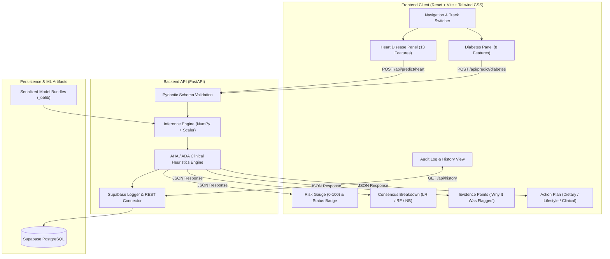

# Cardiose: Explainable Dual-Disease Risk Screening Platform

[](https://fastapi.tiangolo.com)
[](https://react.dev)
[](https://tailwindcss.com)
[](https://scikit-learn.org)
[](https://supabase.com)

**Cardiose** is an accessible, end-to-end clinical decision support platform designed to screen individuals for **Cardiovascular Disease** and **Diabetes Mellitus** using self-reported symptoms and routine laboratory biometrics.

Unlike conventional academic projects that conclude at isolated Google Colab notebooks with opaque binary predictions ($0$ or $1$), Cardiose establishes a unified, cloud-deployable web application. It evaluates each screening concurrently across three supervised learning algorithms, triangulates their probabilities into an intuitive $0\text{--}100$ Risk Score, isolates aberrant physiological drivers ("Why It Was Flagged"), and generates evidence-based dietary and lifestyle prescriptions.

---

## 1. System Architecture



---

## 2. Mandatory Problem Tracks & Algorithms

### 2.1 The Two Problem Tracks
1. **Heart Disease Prediction Track:** Screens coronary artery disease presence based on the **UCI Cleveland Dataset** (`processed.cleveland.data`, 303 instances, 14 clinical features). Multi-class targets ($1\text{--}4$) are binarized to $1$ with high clinical sensitivity.
2. **Diabetes Prediction Track:** Screens diabetic risk based on the **Pima Indians Diabetes Database** (`768` instances, 8 physiological features). Biological zeroes are imputed via feature median.

### 2.2 The Three Supervised Algorithms
Every patient vector is evaluated concurrently across all three estimators to eliminate single-estimator inductive bias:
1. **Logistic Regression (LR):** Establishes the linear log-odds baseline and calibrated probabilities.
2. **Random Forest Classifier (RF):** Models complex non-linear feature interactions (e.g. ST-depression interacting with resting BP and age) with an ensemble of 100 estimators.
3. **Gaussian Naive Bayes (GNB):** Fast conditional probabilistic likelihood estimator assuming class-conditional feature independence.

---

## 3. Mathematical Formulations

### Triangulated Risk Score
$$\text{Risk Score} = \operatorname{round}\left(\frac{P_{\text{LR}} + P_{\text{RF}} + P_{\text{NB}}}{3} \times 100\right)$$

### Risk Categorization Thresholds
- **LOW ($0 \text{ to } 35$):** Biometrics adhere to normal physiological thresholds.
- **MODERATE ($36 \text{ to } 70$):** Borderline indicators; proactive lifestyle interventions recommended.
- **HIGH ($71 \text{ to } 100$):** Multiple aberrant biomarkers; physician consultation and diagnostic lab follow-up advised.

---

## 4. Academic Framing & Literature Comparison (Viva Defense)

| Author & Year | Publication Venue | Dataset & Model | Accuracy | Addressed Research Gap in Cardiose |
| :--- | :--- | :--- | :--- | :--- |
| **Mohan et al. (2019)** | *IEEE Access* | UCI Cleveland (Hybrid RF + Linear) | $88.7\%$ | **Opaque black-box:** Cardiose extracts specific biomarker drivers ("Why It Was Flagged") paired with DASH/ADA dietary guidance. |
| **Singh & Kumar (2020)** | *IEEE ICACCS* | UCI Cleveland (LR, RF, NB) | $85\% \text{--} 89\%$ | **Deployment void:** Singh & Kumar remained offline scripts; Cardiose implements a decoupled production cloud web application. |
| **Sisodia & Sisodia (2018)** | *Procedia CS / IEEE* | Pima Indians (NB, DT) | $76.3\%$ | **Recall neglect:** Used default 0.5 decision thresholds; Cardiose focuses on high-sensitivity clinical screening to minimize false negatives. |
| **Sarwar et al. (2018)** | *IEEE ICAC* | Pima Diabetes (Supervised ML) | $77.5\%$ | **Guidance void:** Isolated diagnostic label without post-screening behavioral, dietary, or clinical follow-ups. |
| **Katarya & Srinivas (2020)** | *IEEE ICESC* | Survey of Chronic Illness Models | Comparative | **Isolated silos:** Modeled diseases separately; Cardiose provides dual cardiovascular & glycemic screening under a unified gateway. |

---

## 5. Local Setup & Execution Guide

### Prerequisites
- Python 3.11+
- Node.js 18+ & npm

### 5.1 Backend Setup
```bash
cd backend

# Create virtual environment (or use uv)
python3 -m venv .venv
source .venv/bin/activate

# Install dependencies
pip install -r requirements.txt

# Run model training (if models are not yet generated)
python train_models.py

# Run test suite
pytest tests/ -v

# Start FastAPI development server
uvicorn app.main:app --reload --port 8000
```
API Documentation will be live at: `http://localhost:8000/docs`

### 5.2 Frontend Setup
```bash
cd frontend

# Install npm dependencies
npm install

# Start Vite development server
npm run dev
```
Open `http://localhost:5173` in your browser.

---

## 6. Supabase Database Setup

To enable cloud persistence, run this SQL script in your [Supabase SQL Editor](https://app.supabase.com):

```sql
create table if not exists cardiose_screening_history (
    id uuid default gen_random_uuid() primary key,
    created_at timestamp with time zone default timezone('utc'::text, now()) not null,
    disease_type text not null check (disease_type in ('HEART', 'DIABETES')),
    risk_score integer not null check (risk_score between 0 and 100),
    risk_level text not null check (risk_level in ('LOW', 'MODERATE', 'HIGH')),
    model_breakdown jsonb not null,
    evidence_points text[] not null,
    action_plan jsonb not null,
    user_inputs jsonb not null
);

-- Enable public read/write access for screening history demo
alter table cardiose_screening_history enable row level security;

create policy "Allow anonymous screening logging" on cardiose_screening_history
    for insert with check (true);

create policy "Allow anonymous reading of history" on cardiose_screening_history
    for select using (true);
```

Add your Supabase credentials to `backend/.env`:
```env
SUPABASE_URL=https://your-project-id.supabase.co
SUPABASE_KEY=your-anon-or-service-role-key
```
*(Note: If Supabase credentials are not set, Cardiose automatically uses an in-memory audit log so demonstrations and tests run smoothly offline).*

---

## 7. Free-Tier Cloud Deployment Guide

### Backend Deployment on Render (Web Service)
1. Push this repository to GitHub.
2. Create a new **Web Service** on [Render](https://render.com).
3. Connect your repository and configure:
   - **Root Directory:** `backend`
   - **Environment:** `Python 3`
   - **Build Command:** `pip install -r requirements.txt`
   - **Start Command:** `uvicorn app.main:app --host 0.0.0.0 --port $PORT`
4. In **Environment Variables**, optionally set `SUPABASE_URL` and `SUPABASE_KEY`.

### Frontend Deployment on Vercel
1. Create a new project on [Vercel](https://vercel.com).
2. Connect your repository and configure:
   - **Root Directory:** `frontend`
   - **Framework Preset:** `Vite`
   - **Build Command:** `npm run build`
   - **Output Directory:** `dist`
3. Add the Environment Variable:
   - `VITE_API_URL` = `https://your-render-backend-url.onrender.com`
